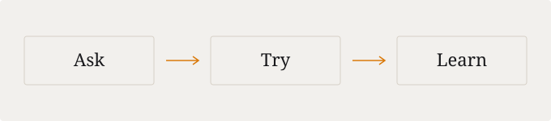

There is something satisfying about a tool that does one thing well. It asks very little of you, gets out of the way, and leaves you with the result you came for.

Writing can work the same way. Start with a question. Follow it far enough to learn something. Leave a clear trail for the next person.

## Less to carry

Before adding a new moving part, I like to ask what it actually makes easier.

| Keep | Make room for |
| --- | --- |
| A clear question | A useful answer |
| A small example | Something you can try |
| A few good links | A way to learn more |

1. Ask a specific question.
2. Try the smallest useful example.
3. Write down what changed your understanding.

That is usually enough for a beginning.
